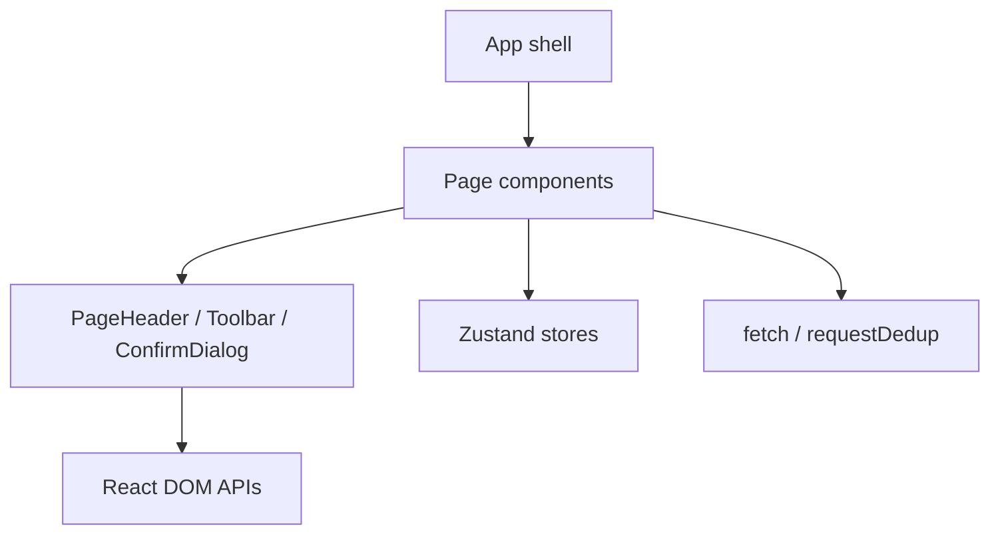

# REVIEW — v27 UI 重构与导航交互统一

- **Change ID**: `v27-ui-rework`
- **日期**: 2026-10-27
- **审查状态**: ⚠️ 暂不进入集成归档；浏览器 E2E 环境不可用，且生产依赖审计存在既有 high 告警。

## 第一轮 · Spec 合规

| AC | 结论 | 证据 / 缺口 |
|---|---|---|
| AC-01 | ✅ | `nav-groups.test.tsx` 10 条跨入口清理回归通过 |
| AC-02 | ✅ | Agent/项目/自动化/任务/编排定向测试通过 |
| AC-03 | ✅ | 导航后旧详情/编辑/创建覆盖态不可见 |
| AC-04 | ⚠️ | 单测和 parity 通过；真实刷新/前进后退/深链未执行 |
| AC-05 | ✅ | PageHeader 统一承载页面 h1；全量 Vitest 通过 |
| AC-06～AC-09 | ✅ | 各页面状态 fixture 与定向测试通过 |
| AC-10 | ⚠️ | 未修改服务端权限；未完成后端可用时的未授权读写 E2E |
| AC-11 | ⚠️ | jsdom 键盘/焦点测试通过；跨浏览器人工走查未执行 |
| AC-12 | ✅ | 保存中/成功/失败反馈由定向测试覆盖 |

未发现本次实现超出 CHANGE.md 范围的后端、数据库或权限修改。

## 第二轮 · 代码质量审查（R1–R6）

### 🟢 R1 · Cognitive Overload：新增确认对话框键盘逻辑集中但仍可读

**Symptom**：`frontend/src/components/ConfirmDialog.tsx:12-43` 同时处理焦点保存、Escape 和 Tab 循环。

**Source**：Fowler，《Refactoring》，Extract Method / 责任聚焦原则。

**Consequence**：未来继续增加对话框行为时可能变长；当前仅 32 行局部逻辑，未达到必须拆分阈值。

**Remedy**：本批不拆；若出现第二种 modal 焦点策略，再提取共享 hook。

### 🟢 R2 · Change Propagation：PageHeader 责任迁移要求旧测试同步

**Symptom**：`frontend/src/__tests__/nav-groups.test.tsx:61-65,257-264` 旧断言仍寻找 `.app-top h1`，与 `AppTopBar` 不再产生页面 h1 的设计冲突。

**Source**：Fowler，《Refactoring》，Change Preventers / Divergent Change。

**Consequence**：页面壳层职责变化会使历史结构断言成批失效。

**Remedy**：已将断言改为页面可见 heading 与 h2 重复标题行为；不引入兼容层。

### 🟢 R3 · Knowledge Duplication：状态语义重复风险受控

**Symptom**：多个页面各自维护 `role=status` / `role=alert` 文案。

**Source**：Hunt & Thomas，《The Pragmatic Programmer》，DRY（知识级重复）。

**Consequence**：不同页面可能出现不同错误措辞，但本 change 的页面状态语义需要保留页面上下文，强行抽象会扩大范围。

**Remedy**：本批不抽象；共享结构仅由 PageHeader/Toolbar/ConfirmDialog 承担。

### 🟢 R4 · Accidental Complexity：无新增依赖

**Symptom**：`ConfirmDialog` 使用原生 DOM 键盘事件与 focus API，没有引入 modal/focus-trap 依赖。

**Source**：Brooks，《The Mythical Man-Month》；Fowler，《Refactoring》，Remove Special Case / Simplify.

**Consequence**：实现面小，避免依赖升级和运行时体积扩大。

**Remedy**：保留当前最小实现；覆盖 Escape、Tab 和焦点回收测试。

### 🟢 R5 · Dependency Disorder：前端组件边界保持单向

**Symptom**：`PageHeader`、`ConfirmDialog` 只依赖 React/DOM；页面未反向依赖后端实现。

**Source**：Martin，《Clean Architecture》，Dependency Rule。

**Consequence**：无新的跨层耦合。

**Remedy**：无需修复。

### 🟢 R6 · Domain Model Distortion：未改变业务状态机

**Symptom**：本 change 只调整页面标题、导航清理、状态呈现和交互反馈；API/store/权限合同未改。

**Source**：Evans，《Domain-Driven Design》，模型边界与表达完整性。

**Consequence**：未发现 UI 迁移把“状态标签”误当执行行为的新增路径。

**Remedy**：保留已有任务/自动化语义说明与定向回归。

### R19 过度工程专项

- ✅ 未新增依赖、状态管理库、路由框架或通用抽象层。
- ✅ ConfirmDialog 使用平台原生 focus/Escape 能力。
- ✅ 未发现需要删除的留置扩展点。

### 架构依赖图

无 `frontend -> backend` 源码导入、无新增循环依赖。

## 第三轮 · UI 视觉与无障碍

- ✅ 页面级标题收敛到 PageHeader，AppTopBar 不再渲染 h1。
- ✅ `PageHeader` h1 `tabIndex=-1`，详情挂载可聚焦。
- ✅ ConfirmDialog 有 `role=dialog`、`aria-modal`、`aria-labelledby`、`aria-describedby`。
- ✅ ConfirmDialog 支持 Escape、Tab 循环和关闭后焦点回收。
- ✅ 全局样式已有 `focus-visible` 与 `prefers-reduced-motion`。
- ⚠️ 颜色对比度未用 Lighthouse/axe 实测；仅有代码层 token 和样式检查。
- ⚠️ Chrome/Firefox/Safari 和 360/768/1024/1440 视口未完成浏览器走查。
- ✅ T11 扫描命中已登记于 `COMPATIBILITY-SCAN.md`，未扩大低频页面改动。

## 第四轮 · 技术债与跨模型

- 技术债触发：本 change 属于 UI 重构，已登记主包 >500 kB、E2E 后端不可用、依赖 audit high。
- 跨模型 spot-check：未执行。当前环境此前后台 subagent 曾因 401 鉴权失败，不能把未执行的审查声称为完成。

## 必须处理的遗留项

1. **T13**：后端 `127.0.0.1:8000` 不可用，`npm run e2e` 退出 2；尝试用 SQLite 启动本地后端时 `/usr/bin/python3` 缺少 `uvicorn`，当前环境无可复用项目 Python 环境；启动可用后需执行真实浏览器走查。
2. **依赖安全**：`npm audit --omit=dev --audit-level=high` 报 `js-yaml` high，以及 `esbuild` / `prismjs` moderate；自动修复可能引入 breaking change，应另立依赖升级任务并重新回归。
3. **性能基线**：主 bundle gzip 约 601.55 kB，需在有正式预算后决定是否拆包。

## 门禁结论

- Spec 合规：✅（自动化部分）/ ⚠️（浏览器与未授权 E2E 未完成）
- 代码质量：✅ 无 Critical 代码质量问题
- UI：⚠️ 自动化无障碍回归通过，人工浏览器和对比度未完成
- **G4：暂不通过集成**，原因是 T13 环境阻塞和依赖安全告警尚未得到人工接受/修复。
